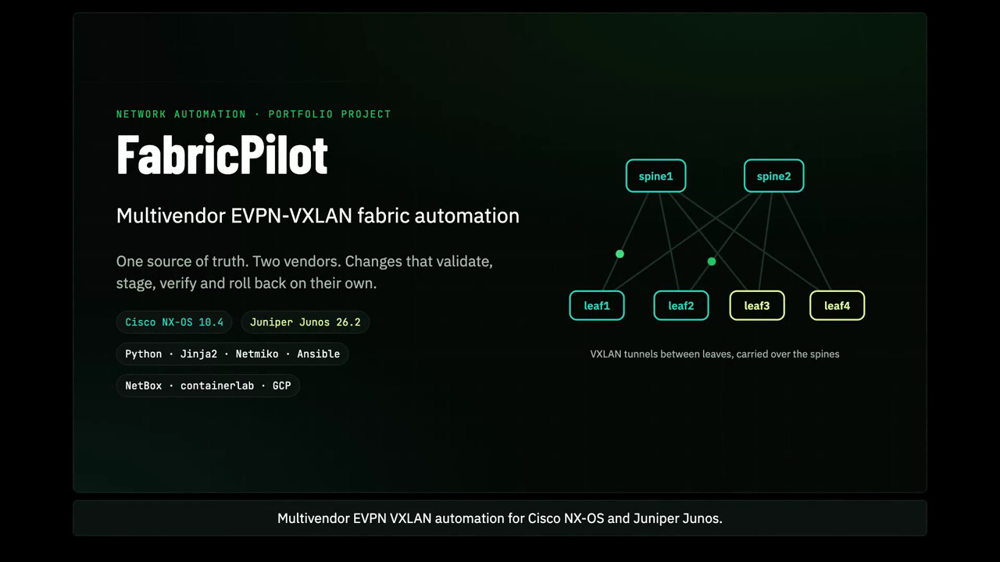

# FabricPilot

**Multivendor EVPN-VXLAN fabric automation: Cisco NX-OS + Juniper Junos**

Safe, staged changes to a Cisco NX-OS + Juniper Junos data center fabric from one source of truth.

## Demo

[](docs/fabricpilot-short.mp4)

**[Watch the 2-minute demo](docs/fabricpilot-short.mp4)**: the problem, the pipeline, the fabric, staged rollout with automatic rollback, the Google Cloud lab, and results on real Cisco and Juniper switches.

**[Evidence from real switches](docs/evidence/)**: deploy logs, an automatic canary rollback, the ping matrix and Ansible output from the live lab.

## Problem

Data center fabric changes are often still made by hand, device by device, in two vendor
syntaxes. That causes outages from typos and duplicate values, lets one bad change hit
every switch at once, and lets the Cisco and Juniper configs drift apart.

This project turns a fabric change into a pipeline that **blocks bad intent, shows exactly
what will change, rolls out in stages, rolls back automatically on failed health checks,
and reports every run by email.**

## Pipeline

```
NetBox / intent YAML
   │
1  VALIDATE   schema + topology rules → reject before anything is generated
2  RENDER     one intent → NX-OS and Junos configs (Jinja2)
3  PLAN       per-device diff vs last deployed state; unchanged devices are never touched
4  ROLLOUT    new spines → canary (1 leaf per vendor) → leaf batches → existing spines
5  GATE       pre/post snapshot per device; failure ⇒ rollback + halt
              (Junos: commit confirmed; NX-OS: checkpoint/rollback)
6  VERIFY     fabric-wide post-check, then HTML + JSON report
7  NOTIFY     email the report (SUCCESS / HALTED / VERIFY_FAILED / BLOCKED)
```

## Fabric

| Device | Vendor | Role | ASN | Loopback |
|---|---|---|---|---|
| spine1 | Cisco NX-OS (Nexus 9000v) | spine | 65000 | 10.255.0.101 |
| spine2 | Cisco NX-OS (Nexus 9000v)¹ | spine | 65000 | 10.255.0.102 |
| leaf1–2 | Cisco NX-OS | leaf / VTEP | 65001–65002 | 10.255.0.1–2 |
| leaf3–4 | Juniper Junos | leaf / VTEP | 65003–65004 | 10.255.0.3–4 |

¹ spine2 was Juniper in earlier runs (it established BGP/EVPN with the Cisco leaves and relayed their routes). It is NX-OS now because three vJunos in one nested-virtualization VM starve each other's control planes; two fit. The Junos spine template is still tested via `intent/junos_mini.yml`.

- **Underlay:** eBGP on /31 point-to-point links, loopbacks advertised
- **Overlay:** eBGP EVPN between loopbacks; spines keep the next hop unchanged and retain all route-targets
- **Services:** VLAN 10 / VNI 10010 (WEB), VLAN 20 / VNI 10020 (APP), symmetric IRB in VRF TENANT1 (L3VNI 50001), distributed anycast gateway with the same MAC on both vendors
- **Interop decisions:** route-targets are always explicit (`65000:<vni>`) because NX-OS and Junos auto-derived RTs don't match; MTU 9216 on fabric links; no multihoming (vPC and ESI-LAG don't interoperate)

## Quick start (no lab needed)

```bash
python3 -m venv .venv && .venv/bin/pip install -r requirements.txt
source .venv/bin/activate

python cli.py validate                                        # ✅ intent valid
python cli.py validate --intent scenarios/bad_duplicate_vni.yml   # ⛔ blocked
python cli.py deploy --simulate                               # greenfield rollout, all waves pass
python cli.py plan                                            # 0 of 6 devices change (idempotent)
python cli.py plan --intent scenarios/add_vni.yml             # only the 4 leaves change; spines untouched
python cli.py deploy --simulate --intent scenarios/add_vni.yml --fail-on leaf1
                                                              # canary fails → rolled back → rollout halted
pytest -q
```

Each deploy writes `reports/<run_id>/report.html`, `report.json` and the email.

### Failure scenarios

| Scenario | Command | Expected result |
|---|---|---|
| Duplicate VNI | `validate --intent scenarios/bad_duplicate_vni.yml` | Blocked; nothing rendered |
| Leaf missing an uplink | `validate --intent scenarios/bad_missing_uplink.yml` | Blocked |
| Overlapping subnet | `validate --intent scenarios/bad_overlapping_subnet.yml` | Blocked |
| Canary breaks after change | `deploy --simulate --fail-on leaf1` | leaf1 rolled back; no other device touched |
| Device unreachable mid-rollout | `deploy --simulate --unreachable leaf3` | Halted safely; report says why |

## Email report

Set these environment variables; without them the email is saved as `reports/<run_id>/report.eml`.

```bash
export REPORT_EMAIL_TO="you@example.com"
export SMTP_HOST="smtp.gmail.com" SMTP_PORT=587
export SMTP_USER="you@gmail.com" SMTP_PASSWORD="<gmail app password>"
```

## Live lab (Google Cloud)

1. Create a VM with nested virtualization. Size it for the switches you run: n2-highmem-8 (8 vCPU / 64 GB, fits the free-trial limit) runs 2 switches (`lab/topology-multivendor-pair.clab.yml`: one Cisco leaf + one Juniper leaf); the full 6-switch fabric was run on 16–24 vCPU / 128 GB. Run at most 2 vJunos per VM (see *Lab limits*).
   ```bash
   gcloud compute instances create evpn-lab --zone=us-east1-b --machine-type=n2-highmem-8 \
     --enable-nested-virtualization --image-family=ubuntu-2404-lts-amd64 \
     --image-project=ubuntu-os-cloud --boot-disk-size=200GB \
     --max-run-duration=3h --instance-termination-action=STOP
   ```
2. Copy this repo to the VM and run `bash lab/setup_vm.sh` (Docker, containerlab, vrnetlab, NetBox).
3. Copy the Nexus 9000v and vJunos-switch `.qcow2` images to `~/images/`, then run `bash lab/setup_vm.sh images`.
4. `sudo containerlab deploy -t lab/topology.clab.yml`. The topology is **generated from the intent file** (`lab/gen_topology.py`), and CI fails if they drift.
5. Seed NetBox: `NETBOX_TOKEN=... python netbox/sync.py push`
6. Deploy from NetBox:
   ```bash
   python netbox/sync.py pull > intent/from_netbox.yml
   export FABRIC_PASSWORD_NXOS=admin FABRIC_PASSWORD_JUNOS=admin@123
   python cli.py plan   --intent intent/from_netbox.yml --live
   python cli.py deploy --intent intent/from_netbox.yml --live
   ```
7. Test the data plane: `sudo docker exec clab-lab-fabric-host1 ping 10.10.10.13` (Cisco leaf to Juniper leaf, same VLAN).

**Stop the VM after every session:** `gcloud compute instances stop evpn-lab --zone=us-east1-b`

Alternative deploy path: `ansible-playbook ansible/deploy.yml --check --diff` (vendor collections, `serial` staging, Junos commit confirmed).

## Repository layout

```
intent/fabric.yml        source of truth (NetBox-shaped)
fabric/models.py         validation: schema + topology/addressing/overlay rules
fabric/render.py         intent → per-device data → configs
templates/               nxos_{spine,leaf}.j2, junos_{spine,leaf}.j2
fabric/plan.py           per-device diff vs deployed state
fabric/rollout.py        waves, health gates, rollback, fabric-wide verify
fabric/drivers.py        SimDriver (demo/tests) and NetmikoDriver (live)
fabric/report.py         HTML/JSON report + email
cli.py                   validate | render | plan | deploy
netbox/sync.py           NetBox push (bootstrap) / pull (export to intent)
lab/                     containerlab topology generator, VM setup script
ansible/                 alternative staged deploy with vendor collections
scenarios/               valid and invalid change examples
tests/                   54 tests: validation, rendering, rollout safety, live-driver parsing
docs/                    2-minute demo video
```

## Status

| Component | Status |
|---|---|
| Validation, rendering, planning, rollout logic, reporting | ✅ Tested (54 unit tests, simulated rollouts) |
| Junos templates + live driver | ✅ **Deployed live** to vJunos-switch 26.2R1.7 (spine2 + leaf3): underlay and EVPN BGP established, anycast gateway answering host ping, staged rollout with convergence-aware health gates, `commit confirmed` + automatic rollback exercised |
| NX-OS templates + live driver | ✅ **Deployed live** to Nexus 9000v 10.4(8) (spine1, leaf1, leaf2): underlay and EVPN BGP established, leaf1↔leaf2 VXLAN tunnel up, host1 (VLAN 10) ↔ host2 (VLAN 20) routed over the L3VNI |
| Full 6-switch fabric | ✅ With 3 × NX-OS + 3 × Junos, all six deployed by the pipeline and the fabric-wide check passed (BGP and VTEP peers healthy on every switch). ⚠️ Later full rebuilds did not finish inside one session: Junos commits on a loaded vJunos took 15–30+ min, so runs halted safely at the canary (see *Lab limits*) |
| Cisco ↔ Juniper EVPN interop | ✅ **L2 over VXLAN across vendors**: host1 (NX-OS leaf1) ↔ host3 (Junos leaf3), both directions. **Routing between VLANs across vendors** after adding symmetric IRB on Junos: host2 (NX-OS, VLAN 20) ↔ host3 (Junos, VLAN 10). Overnight run (spine2 on Junos): 9/9 ping paths pass between the deployed leaves (9/16 overall; leaf4 was not deployed). Final run with spine2 on NX-OS halted safely at the leaf3 canary (4/16), see *Lab limits* |
| Ansible playbook | ✅ **Run live** in check mode with `--diff` against the deployed Cisco switches: `changed=0` on spine1, leaf1, leaf2, so Ansible independently agrees with the pipeline; `serial` staging ran as separate plays |
| NetBox sync | ✅ **Live against NetBox 4.7.2** (v2 API token): `push` loaded 6 devices, 8 cables, 2 VNIs; `pull` → rendered configs **byte-identical** on all 6 switches; adding VLAN 30 in NetBox made `plan` change exactly the 4 leaves and no spines |

### Found on real devices (and fixed)

| Finding | Fix |
|---|---|
| vJunos rejects `mtu 9216` (range 256..9192) | Junos templates cap MTU at 9192; NX-OS keeps 9216 |
| Health gate checked before BGP converged → would roll back good changes | Gate polls until healthy or `--settle-seconds` expires |
| Junos appends `# commit confirmed will be rolled back...` after JSON | Parse only the first JSON document (fixture from real output) |
| Slow CLI: stale prompts, >10 s echo, >120 s commits desynced Netmiko | Explicit prompt patterns, buffer clearing, longer commit timeouts |
| Line-by-line config push (and Netmiko SCP checks) desynced on a slow device | Whole config pasted into `load set terminal` in one write; all errors reported at once |
| 3 vJunos on 8 vCPU never finished booting | Topology generator staggers boots on small VMs (`FABRIC_PARALLEL_BOOTS`) |
| NX-OS rejects `.` in checkpoint names, and the driver carried on **without a rollback point** | Safe checkpoint names; the driver now **refuses to apply** if the checkpoint fails |
| NX-OS prints nothing for an empty `\| json` table (`show nve peers` with no peers) | Read ends at the prompt after the echoed command; empty counts as zero |
| `advertise l2vpn evpn` is deprecated with no effect on NX-OS 10.4 | Removed from the NX-OS leaf template |
| vJunos reports container-healthy before sshd accepts logins | Connection (never config) retried 4× with 30 s backoff |
| Loaded vJunos took ~7.5 min after commit to establish BGP with NX-OS; a 7 min gate rolled back a good change | Gate deadline is a per-environment setting: lab runs use `--settle-seconds 900 --confirm-minutes 25` (switch-side rollback timer must outlast the gate) |
| **Cisco never learned Junos hosts** although BGP and VTEPs were up: Junos default-switch (VLAN-aware bundle) sends EVPN routes with Ethernet Tag = VNI, NX-OS (VLAN-based) silently drops them | Junos leaves use one `mac-vrf` per VNI with `service-type vlan-based` (Tag 0); template deletes and rebuilds its sections in one commit |
| Netmiko's `commit()` gave up while a large Junos commit was still running | Commit sent explicitly; driver waits for `commit complete` or an error |
| A timeout in the confirm step crashed the run: no halt recorded, no report | Confirm failures are handled like any failed device (rollback attempt, halt, report); Junos config mode entered/left with explicit long waits |
| vJunos data plane busy-polls ~3 of its 4 vCPUs, starving commits and SSH (MAC-VRF commit >15 min) | Commit timeout is configurable (`FABRIC_COMMIT_TIMEOUT`); lab runs use 1800 s |
| **Ansible check mode** flagged NX-OS lines as changed on every run: NX-OS stores `route-target both` as import + export and hides access-port defaults | NX-OS template writes the running-config form; Ansible now reports `changed=0` |
| Junos leaves routed traffic asymmetrically while NX-OS is symmetric, so routing between VLANs failed across vendors | `irb-symmetric-routing vni <L3VNI>` in the Junos tenant VRF; Cisco ↔ Juniper routed pings pass |
| NetBox 4.7 issues v2 API tokens (`nbt_<key>.<secret>`, Bearer auth) | Token provisioned via `/api/users/tokens/provision/`; stored on the lab VM only |
| After a lab VM restart the switches are blank, but `state/deployed` still lists them, so `plan` would skip them | Clear (move aside) `state/deployed` whenever the lab is rebuilt |

### Tuning the health gate

`--settle-seconds` is how long a device may take to converge before its gate fails, and
`--confirm-minutes` is the Junos switch-side auto-rollback timer. Keep the timer longer
than commit time + settle time, or the switch rolls back before the pipeline confirms.
Hardware converges in seconds; this nested-virtualization lab needs minutes.

| Environment | `--settle-seconds` | `--confirm-minutes` |
|---|---|---|
| Physical switches | 60–120 | 5 |
| Lab VM, lightly loaded | 300 | 15 |
| Lab VM, 6 switches on 16 vCPU | 900 | 45 (and `FABRIC_COMMIT_TIMEOUT=1800`) |

## Lab limits

The lab runs real vendor images under nested virtualization on one Google Cloud VM. vJunos-switch's
virtual data plane busy-polls every vCPU it is given (measured ~330% of 4 vCPUs, ~600% of 6),
which leaves its control plane starved: Junos commits took 15–30+ minutes and SSH was refused while
they ran. Two vJunos per VM work; three do not, at any VM size tried (8, 16, 24 vCPUs). On real
switches, or with fewer virtual Junos instances, these timings drop to seconds.

## Known limitations and next steps

- Config push is merge-only: removing something from intent doesn't delete it from the device yet. Next step: Junos `load override` and NX-OS `configure replace`.
- NX-OS rollback is driven by the pipeline (checkpoint/rollback). Junos has a device-side timer. Next step: NX-OS `configure replace ... commit-timeout` for the same guarantee.
- Health checks cover BGP sessions and VTEP peers. Next step: EVPN route counts, MAC/ARP tables, host-to-host ping.
- Drift detection: scheduled comparison of running config against intent.
